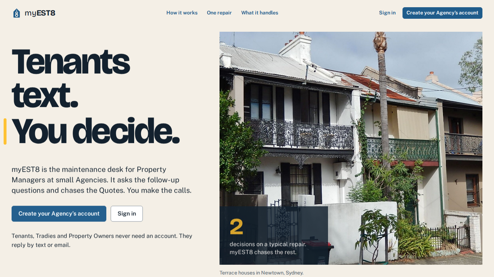

# Implementation

This page describes myEST8 as it was built and as it runs in production today. The plan it started from is on the [Implementation Plan](implementationPlan.md) page. Where the build moved away from that plan, the reason is on the [Implementation Report](implementation-report.md) page.

- **Live app:** <https://myest8.vercel.app> (production, deployed from `master`)
- **Source code:** <https://github.com/SweetTooth05/myEST8>
- **Status:** feature-complete MVP, in User Acceptance Testing (see [UAT Testing](testing.md))



## 1. What myEST8 does

myEST8 is a maintenance desk for small property management Agencies (3–4 Property Managers). Tenants report repairs on the channels they already use. myEST8 does the back-and-forth that normally fills a Property Manager's day: follow-up questions, photos, quotes, owner approval, booking and updates. The Property Manager steps in only to make decisions.

The end-to-end workflow:

1. **Report.** A Tenant texts or emails the Agency, for example "the tap under the kitchen sink keeps dripping".
2. **Intake.** The AI agent matches the sender to a Tenant and classifies the message (new issue, update, Common Area issue or other). It sets the **Urgency** (Urgent / High / Routine) and the **Trade**. It pulls out any details the Tenant already gave and asks only for the ones still missing, in a single message. Then it sends a no-login photo upload link.
3. **Check.** Each photo is checked against its metadata (EXIF date and location) and against the description. Claude Haiku writes a one-line **Summary**, and the request waits on the Dashboard as a **Maintenance Request**.
4. **Confirm.** The Property Manager reads the Summary, photos and checks, edits anything if needed, and confirms. That creates a numbered **Ticket**, and the Tenant gets a link to a progress tracker.
5. **Urgent Repairs** never become Tickets. The Tenant is told to arrange the repair with the Property's Nominated Tradie and can claim up to $1,000 back. Their receipt becomes a **Reimbursement Request**, which the Property Manager checks and forwards to the Owner.
6. **Quote.** myEST8 recommends Tradies for the Job and sends Quote Requests. Each Tradie gives an **Estimate** on a no-login quote page, says whether they need a **Site Inspection**, and then gives a **Firm Quote**. Firm Quotes are compared side by side.
7. **Approve.** If the chosen quote would take the Ticket's Repair Cost over the Property's **Max Repair Cost**, the Owner is asked to reply YES or NO. Reminders go out at 24 h, and the Property Manager is alerted at 48 h.
8. **Book.** The chosen Tradie offers a preferred visit time plus up to two more. The Tenant picks one and the Work Order goes out already confirmed. Either side can ask for another time.
9. **Close.** The Tradie reports the Job done and the Tenant is asked "Was it fixed properly?". The Property Manager rates the Tradie, and both ratings feed future recommendations.

Only Property Managers have accounts. Tenants, Tradies and Property Owners never sign up. They use SMS, email or WhatsApp, plus a few single-purpose no-login links: photo upload, receipt upload, quote page, visit picker and progress tracker.

## 2. Features delivered

| # | Core feature (from the design) | Status | How it was built |
|---|---|---|---|
| 1 | Channel connections and onboarding guide | Built | Welcome wizard, Setup page and Settings → Channels share one component. SMS goes through textbee, email through Resend, and WhatsApp through the Meta Cloud API on the server's number. Messenger, Telegram, WeChat and LINE are shown as "Coming later". |
| 2 | AI intake agent | Built | `src/intake.ts`. Jev classifies every inbound message, with Claude Haiku as the fallback. Low-confidence messages go to the Inbox instead of being acted on. |
| 3 | Photo upload and verification | Built | No-login upload page (`/u/:token`) that uploads straight to Supabase Storage. Photo metadata is read with `exifr`. The image-to-description match runs behind a gateway contract (see [§5](#5-ai-in-myest8)). |
| 4 | Urgency ranking | Built | Urgent / High / Routine. Urgent Repairs go back to the Tenant with the Nominated Tradie and a receipt link. The Dashboard sorts by Urgency, then by submission time. |
| 5 | Profiles | Built | One Profiles page for households, Owners, Tradies and Building Managers. Details are edited in place. Each profile has a one-sentence "read" built from its history (ADR 0018). Spreadsheet import (CSV/XLSX) is available for bulk records. |
| 6 | Tradie recommendation | Built | Nominated Tradies come first, then a weighted blend: myEST8 rating 0.4, Google rating 0.2, Jev **job fit** 0.3 and price 0.1. Each part is shown in its own column and never merged into one score. |
| 7 | Quote requests and comparison | Built, extended | Estimate → optional Site Inspection → Firm Quote, tracked separately for each Tradie. A Firm Quote is always required. Reminders go out at 48 h, with a prompt to invite more Tradies at 72 h. |
| 8 | Owner approval | Built | Asked only when the Max Repair Cost would be exceeded. Jev reads the Owner's YES/NO reply. Quotes already approved stay approved. |
| 9 | Shared calendar and scheduling | Built | A week-view **Schedule** with today's time line and a "Free today" list, plus a **Dispatch** map (MapLibre over OpenStreetMap) showing Properties and nearby Tradies. Tradies offer visit times and Tenants pick one (ADR 0015). |
| 10 | Automated updates | Built | Sent at each status change on the right channel: the last-used channel within 24 h, otherwise SMS, otherwise email. Claude Haiku composes emails, and code checks that every amount, link and time is still there. |
| 11 | Ratings | Built | The Property Manager rates 1–5, and the Tenant answers "Was it fixed properly?" (1–5). Both feed the myEST8 rating. |
| 12 | Progress tracker | Built | A no-login Tenant page (`/t/:token`) showing Reported → Confirmed → Getting quotes → Approved → Booked → Done → Closed. It never shows prices, Quotes or ratings. |

Additions not in the original design, driven by testing and feedback:

- **AI follow-up drafts.** The Property Manager types a rough note, presses *Draft with AI*, edits the draft and sends it. Every AI-written message is marked ✦✦ ("Written by AI").
- **Approvals page:** everything waiting on an Owner, with the amount and how long it has been waiting.
- **Archive** of closed Tickets, and a Dashboard "Next 7 days" view.
- **Team management:** invite or remove a Property Manager and edit the Agency.
- **Shared contact addresses:** several people in one household can share a mobile or email. A message from a shared address is read as the person the Agency most recently asked.

The secondary features from the design (FAQ, chatbot, Tradie sign-up, Tenant check-ins, quests, voice) remain out of scope for the MVP.

## 3. Architecture

myEST8 is **one app with internal modules**, not microservices (ADR 0001). It is a TypeScript server built on [Hono](https://hono.dev/) and renders HTML pages on the server. JavaScript is added only where a page needs it, such as the map, the upload page and in-place editing.

```
                 SMS (textbee)   Email (Resend)   WhatsApp (Meta)
                        │              │                │
                        └──── signed webhooks ──────────┘
                                       │
   Property Manager ──HTTPS──▶  Hono app (api/index.ts on Vercel)
   Tenant / Tradie no-login links ─▶   │
                                       ├── intake ──── Jev (classify) / Claude Haiku (extract, summarise)
                                       ├── tickets
                                       ├── quotes ───── Jev (job fit), Google Places (ratings)
                                       ├── scheduling
                                       ├── notifications ── Claude Haiku (compose) → template fallback
                                       ├── profiles / imports
                                       └── worker (background tasks: reminders, judgments, sends)
                                       │
                         Supabase Postgres  +  Supabase Storage (photos, receipts, PDFs)
```

### Modules (`src/`)

| Module | Responsibility |
|---|---|
| `intake.ts` | Sender matching, classification, guided questions, photo requests, Urgent Repairs |
| `tickets.ts` | Maintenance Requests, Tickets, Jobs, status timeline |
| `quotes.ts` | Tradie ranking, Quote Requests, Estimates, Site Inspections, Firm Quotes, Owner approval |
| `scheduling.ts` | Work Orders, visit offers, rescheduling, the shared calendar |
| `notifications.ts`, `templates.ts`, `composing.ts` | Choosing the channel, message templates, AI composition with fact checks |
| `profiles.ts`, `profile-reads.ts`, `imports.ts` | People and Properties, profile reads, spreadsheet import |
| `onboarding.ts`, `channel-verification.ts` | Sign-up, the welcome wizard, connecting Channels |
| `worker.ts` | Background task queue: reminders, AI judgments and delivery retries |
| `ports.ts` + `adapters/` | One interface per external service, each with a real adapter and an in-process mock |
| `web/pages/` | 30 server-rendered pages (Dashboard, Dispatch, Schedule, Approvals, Profiles, Ticket, Settings, …) |

**Ports and adapters.** Every external service sits behind a port: classifier, summariser, composer, image matcher, quote reader, Places, geocoder, messenger and file storage. Each port has a real adapter and a mock. That is how the same code runs as the offline demo, in the test suite and in production. In production the app refuses to start if any required service is still mocked.

**Background work.** Vercel has no long-running process. The worker therefore runs straight after every webhook or upload, and a cron route (`/api/cron/worker`) drains anything due every 5 minutes. Tasks are claimed atomically, so two runs never take the same task. A task whose run died is retried after 10 minutes.

**Data.** Postgres has 17 additive migrations under `supabase/migrations/`. Row-level security is on with no policies, so Supabase's public API can read nothing. The app does its own per-Agency authorisation. Writes take a per-schema advisory lock, so a check made inside a transaction ("is this Job still choosing a Quote?") still holds when it writes.

## 4. Technology stack

| Layer | Technology | Why |
|---|---|---|
| Language and runtime | TypeScript on Node.js 22 | One language for server, scripts and tests |
| Web framework | Hono, server-rendered HTML | Small and fast, runs unchanged on Node and on Vercel functions |
| Styling | Tailwind CSS 4 + daisyUI, Bricolage Grotesque and Public Sans, Phosphor icons | A consistent design system (`docs/design-system.md` in the repo) that works on phone and desktop |
| Maps | MapLibre GL over OpenFreeMap tiles | Free, no API key, and drawn from the same OpenStreetMap data as the geocoder |
| Database | PostgreSQL 17 (Docker locally, Supabase in production) via postgres.js | Transactions and locking for concurrent Property Managers |
| File storage | Supabase Storage (private bucket, signed upload URLs) | Phone photos are larger than Vercel's ~4.5 MB request cap |
| Hosting | Vercel function (region `icn1`, next to the database) | Free tier, HTTPS and fixed webhook URLs |
| CI/CD | GitHub Actions: test → build → migrate → deploy → smoke test; weekly encrypted backup; manual rollback | Every production deploy is tested first, and Vercel's own auto-deploy is turned off |
| Testing | Vitest (unit and integration on real Postgres), Playwright (browser end-to-end) | See [UAT Testing → Automated testing](testing.md#automated-testing-before-uat) |

### External services

| Need | Service | Decision record |
|---|---|---|
| SMS | **textbee**: an Android phone with a SIM acts as the gateway | ADR 0013. Twilio rejected our Australian regulatory bundle, and a trial account can't send custom text. |
| Email in and out | **Resend**, with an inbound subdomain the Agency forwards or CCs to | ADR 0006. SendGrid's free plan was retired, and Gmail OAuth tokens expired every ~7 days in Testing mode. |
| WhatsApp | **Meta WhatsApp Cloud API** on the server's number | ADR 0019 |
| Message classification, job fit, request judgments | **Jev** (TypeSafe AI System One) | ADR 0011, 0016, 0018 |
| Summaries, composing emails, extracting guided answers, follow-up drafts | **Claude Haiku** (Anthropic) | ADR 0008, 0011, 0014 |
| Tradie listings and Google ratings | **Google Places API (New)** | ADR 0012 |
| Geocoding and address suggestions | **Nominatim** and **Photon** (OpenStreetMap) | ADR 0012. Google Geocoding needs billing enabled. |

## 5. AI in myEST8

The design rule is **each model does the job it suits, and code owns the facts.**

- **Jev classifies what comes in.** Each incoming message becomes a set of typed questions with fixed answers: kind of message, what it relates to, Urgency, Trade, update type and the Owner's yes or no. Jev answers them all in one pass, with a probability for each answer. Below a confidence threshold, the message goes to the Inbox rather than being acted on. Jev also scores **job fit** (how closely a Tradie's past work matches this repair, on four levels) and judges each Maintenance Request once for the Tenant's profile read.
- **Claude Haiku writes what goes out.** It writes the one-line Summary, composes outbound emails and drafts follow-ups, and it pulls the guided details (where, since when, getting worse, availability) out of a Tenant's free text.
- **Guardrails:**
    - Haiku gets the facts as structured data, and a Tenant's own words are passed as untrusted data, never as instructions.
    - Code extracts every amount, date, link, phone number and button line from the template, and Haiku's draft is sent only if it contains all of them word for word and adds none.
    - Otherwise, or if Haiku is slow (8 s) or down, the fixed template is sent. Sending never depends on a model.
    - SMS, WhatsApp and verification messages are always template text.
    - Profile sentences are written by code from counts, never by a model, so a model is never the thing that says a Tenant caused damage.
- **Not chosen yet:** a vision model for the photo-to-description match, and a model for reading prices out of PDF quotes. Both are defined as gateway contracts (`image-matcher.ts`, `quote-reader.ts`), and the Property Manager confirms every result. Tradies type their quotes on the no-login quote page, so PDF reading isn't on the critical path.

## 6. Security and privacy measures

- Passwords are hashed. Sign-in errors don't reveal whether an email exists. State-changing requests have same-origin checks.
- All provider webhooks are signature-checked: textbee HMAC-SHA256, Meta `X-Hub-Signature-256`, Resend and Twilio signatures. An unknown or bad signature gets the same 403.
- No-login links use unguessable per-item tokens and are rate limited. Opening a link never changes anything; a button press does.
- Stored third-party credentials are encrypted with AES-256-GCM.
- Database backups are piped straight into `age` encryption, so no plaintext dump exists.
- Only made-up data is used. The Supabase project is in an Asia-Pacific region.

The no-login pages have **not** had an independent security review yet. That is listed under known limitations in the [Implementation Report](implementation-report.md#7-known-limitations).

## 7. Environments

| Environment | Command | Data | External services |
|---|---|---|---|
| Local demo | `npm run demo` | Throwaway schema, seeded Agency "Harbour Realty" with ten days of stories | All mocked, plus a phone simulator and a movable clock |
| Local dev | `npm run dev` | Schema `dev`, kept across restarts | Mocked unless env vars are set |
| Production locally | `npm run prod:local` | Fresh local database | Mocked, but runs the production entry point |
| Tests and CI | `npm run check` | A database per run, a schema per test | Fakes at every port |
| Production | push to `master` | Supabase Postgres + Storage | Real: textbee, Resend, Meta, Jev, Claude, Google Places, Nominatim |

How to run the project is covered in the myEST8 repository's README and `docs/` folder.
